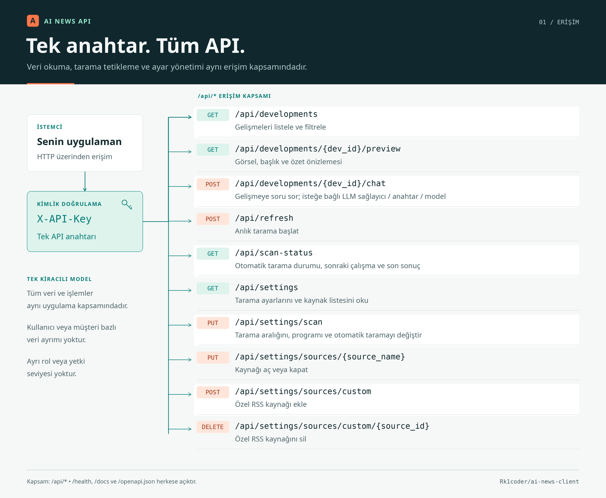
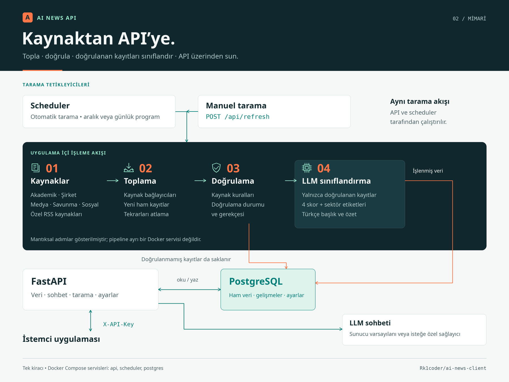

# AI News — API

AI/teknoloji dünyasındaki gelişmeleri onlarca kaynaktan otomatik toplayan,
güvenilirliğine göre doğrulayan, bir LLM ile önceliklendirip Türkçe'ye
çeviren ve sonucu bir HTTP API üzerinden sunan arka uç servisi.

Web arayüzü içermez — bu, projenin saf API/backend dağıtımıdır: herhangi
bir kullanıcı `docker compose up` ile kendi örneğini ayağa kaldırır ve
`X-API-Key` ile tüm işlevlere programatik olarak erişir.

## İçindekiler

- [Nasıl çalışır](#nasıl-çalışır)
- [Özellikler](#özellikler)
- [Hızlı başlangıç](#hızlı-başlangıç)
- [Yapılandırma](#yapılandırma)
- [API](#api)
- [Proje yapısı](#proje-yapısı)
- [Yedekleme](#yedekleme)

## Nasıl çalışır





İki bağımsız servis aynı veritabanını paylaşır:

- **`api`** (FastAPI, `:8008`) — dış istemcilerin `X-API-Key` ile çağırdığı
  HTTP katmanı. Veritabanını okur/yazar; veri toplama mantığına dokunmaz.
- **`scheduler`** — kullanıcıdan bağımsız, kendi döngüsünde şu hattı tetikler:
  1. **Ingestion** — RSS, Arxiv, HackerNews, HuggingFace Daily Papers, Substack
     ve şirket blogları dahil onlarca kaynaktan yeni içerik çeker.
  2. **Verification** — kaynak türüne göre güvenilirlik ağırlığı uygular
     (`academic`/`company`/`media` tek kaynakla yeterli sayılır; `defense`/`social`
     çapraz teyit gerektirir ve teyit mantığı devreye girene kadar beklemede kalır).
  3. **Classification** — doğrulanan her kaydı bir LLM'e (Anthropic Claude veya
     Gemini) gönderip teknik etki/hype/uygulanabilirlik/öncelik skorları,
     Türkçe başlık ve özet üretir.
  4. Sonuç PostgreSQL'e yazılır; isteğe bağlı olarak Telegram'a bildirim
     kuyruğa alınır.

## Özellikler

- **Çoklu kaynak toplama**: RSS/Atom, Arxiv, HackerNews, HuggingFace Daily
  Papers, Substack konu akışları, şirket blogları (JSON-LD destekli) —
  `src/ai_news_radar/ingestion/`.
- **Kaynak güvenilirliğine duyarlı doğrulama**: her kaynak türü için farklı
  eşik ve çapraz teyit gerekliliği — `src/ai_news_radar/verification/`.
- **LLM sınıflandırma + çeviri**: Anthropic Claude veya Gemini ile skorlama,
  özetleme ve Türkçe çeviri; istek bazında sağlayıcı/anahtar/model geçersiz
  kılınabilir — `src/ai_news_radar/classification/`.
- **Geliştirme bazlı sohbet**: herhangi bir gelişme hakkında LLM'e soru sorma.
- **Haftalık dijest**: toplanan gelişmelerin özetlenmiş hali.
- **Esnek tarama programı**: sabit saatler veya dakika bazlı aralık,
  zaman dilimi destekli — `src/ai_news_radar/scan_program.py`.
- **Telegram bildirimleri** (opsiyonel): yeni/öncelikli gelişmeler için kuyruklu
  gönderim — `src/ai_news_radar/notifications/`.
- **Arama**: başlık/özette Türkçe+İngilizce metin arama — `src/ai_news_radar/search.py`.

## Hızlı başlangıç

```bash
cp .env.example .env
# .env içini doldurun: POSTGRES_PASSWORD, ANTHROPIC_API_KEY, API_KEY vb.
docker compose up -d --build
```

Servisler:

| Servis | Açıklama |
|---|---|
| `postgres` | Veritabanı |
| `api` | FastAPI uygulaması — `http://localhost:8008` |
| `scheduler` | Otomatik tarama döngüsü (API'den bağımsız container) |

Sağlık kontrolü: `curl http://localhost:8008/health` → `{"status": "ok"}`.

## Yapılandırma

Tüm değişkenler ve açıklamaları [.env.example](.env.example) içinde. Öne çıkanlar:

| Değişken | Açıklama |
|---|---|
| `DATABASE_URL` | PostgreSQL bağlantı dizesi |
| `LLM_PROVIDER` | `anthropic` (varsayılan) veya `gemini` |
| `ANTHROPIC_API_KEY` / `GEMINI_API_KEY` | Seçilen sağlayıcının anahtarı |
| `API_KEY` | `/api/*` isteklerinde zorunlu `X-API-Key` değeri; boşsa doğrulama kapalı (yalnızca yerel geliştirme) |
| `AUTO_SCAN_ENABLED`, `SCAN_HOURS` / `SCAN_INTERVAL_MINUTES`, `SCAN_TIMEZONE` | Otomatik tarama programı |

## API

Tüm uç noktalar, istek/yanıt şemaları ve kimlik doğrulama detayı:
**[docs/api.md](docs/api.md)**.

İnteraktif şema (Swagger UI, auth gerektirmez): `http://localhost:8008/docs`.

Özetle bir istemci `X-API-Key` ile şunları yapabilir: gelişmeleri filtreleyip
listelemek, bir gelişme hakkında sohbet etmek, manuel tarama tetiklemek,
tarama durumunu görmek, kaynak/program ayarlarını değiştirmek.

## Proje yapısı

```
src/ai_news_radar/
├── web/              FastAPI uygulaması, uç noktalar
├── ingestion/        Kaynak bağlayıcıları (RSS, Arxiv, HackerNews, ...)
├── verification/     Kaynak güvenilirliği kuralları
├── classification/   LLM sınıflandırma, çeviri, dijest, sohbet
├── notifications/    Telegram bildirim kuyruğu
├── pipeline.py        ingest → verify → classify akışı
├── scheduler.py       Periyodik tarama döngüsü
└── scan_program.py    Tarama zamanlama mantığı
tests/                 pytest test paketi
scripts/backup.sh      PostgreSQL yedekleme betiği
docs/api.md            API referansı
```

## Yedekleme

```bash
./scripts/backup.sh
```
